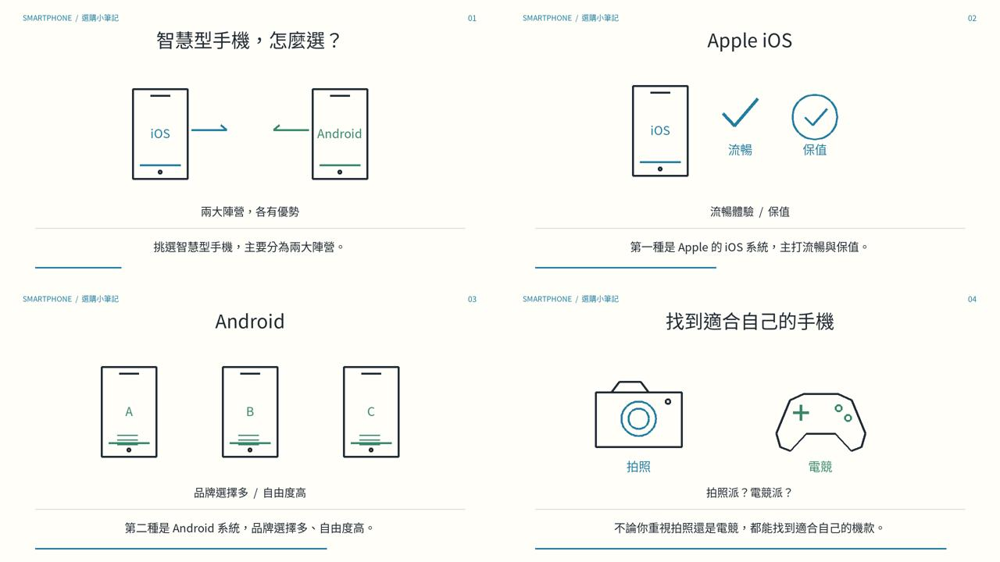
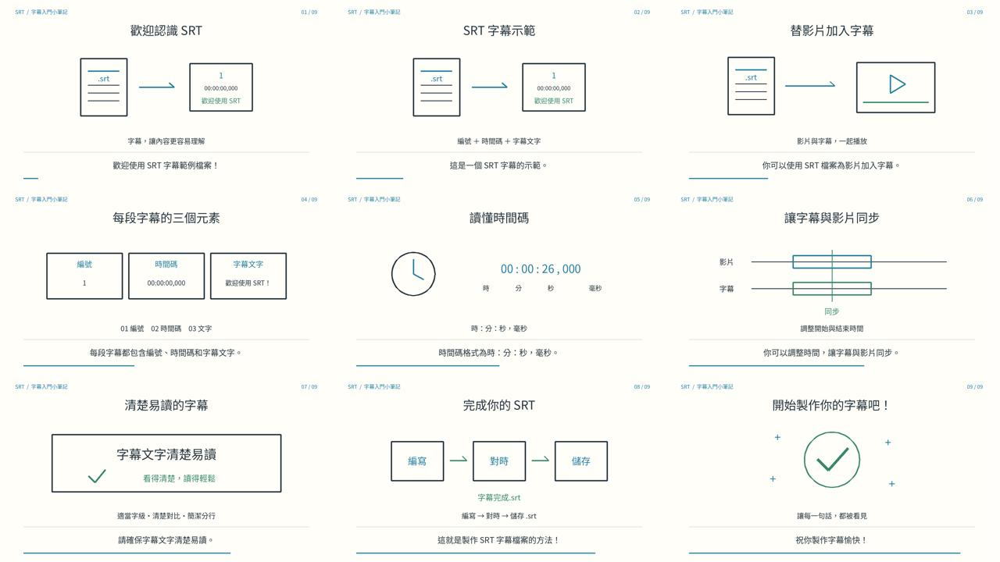

# 智慧型手機選購：白板動畫

依據四段繁體中文 SRT 製作的 14 秒白板線條動畫，內容涵蓋 iOS、Android、拍照及電競需求。

[下載／播放 MP4](videos/smartphone-whiteboard.mp4) · [SRT 字幕](subtitles/smartphone.srt) · [製作程式](src/render.py)



影片規格：1280 × 720、30 fps、H.264 MP4，字幕已嵌入畫面，無配音。

## 重新製作

需要 Python 3、Pillow、FFmpeg 及 Noto Sans CJK 字型。
程式預設使用 Linux 字型路徑 `/usr/share/fonts/opentype/noto/NotoSansCJK-Regular.ttc`，其他系統請調整 `src/render.py` 的 `font` 變數。

從儲存庫根目錄執行：

```bash
cd srt-whiteboard-animation
python -m pip install -r requirements.txt
python src/render.py
```

輸出至本專案的 `work/`（程式會自動建立）：影片 `smartphone-whiteboard.mp4`、字幕 `smartphone.srt` 及場景預覽 `preview.jpg`。

時間軸：

- 00:01.000–00:03.500：挑選智慧型手機，主要分為兩大陣營。
- 00:03.800–00:06.800：第一種是 Apple 的 iOS 系統，主打流暢與保值。
- 00:07.200–00:10.200：第二種是 Android 系統，品牌選擇多、自由度高。
- 00:10.600–00:14.000：不論你重視拍照還是電競，都能找到適合自己的機款。

## 檔案分類

- `src/`：動畫製作程式。
- `videos/`：完成的 MP4 影片。
- `subtitles/`：SRT 字幕。
- `previews/`：場景預覽圖片。
- `requirements.txt`：Python 相依套件。

## 範例二：SRT 字幕入門

九段字幕的 58 秒白板動畫，介紹 SRT 格式、字幕時間碼、同步與易讀性。保留原始字幕時間，無配音。

[下載／播放 MP4](videos/srt-intro-whiteboard.mp4) · [SRT 字幕](subtitles/srt-intro.srt) · [製作程式](src/render_srt_intro.py)



從儲存庫根目錄執行：

```bash
cd srt-whiteboard-animation
python -m pip install -r requirements.txt
python src/render_srt_intro.py
```

產生的影片、字幕與預覽圖會放在本專案的 `work/srt-intro/`。
